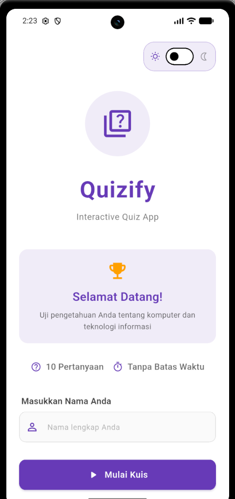
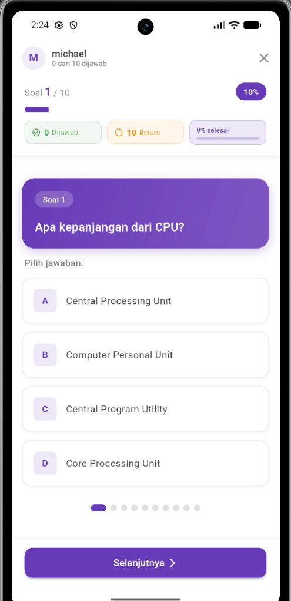
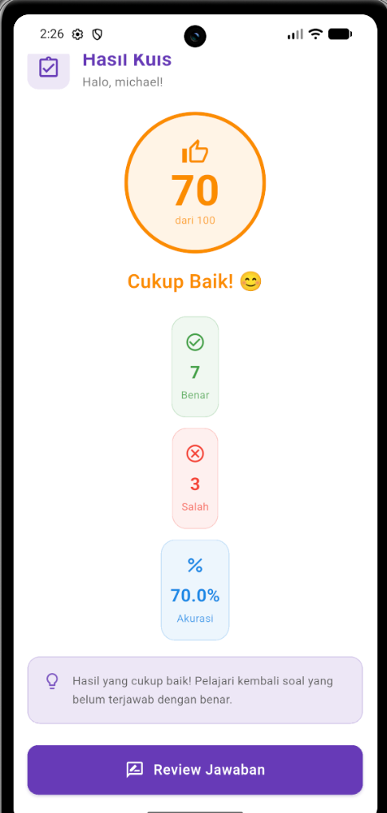
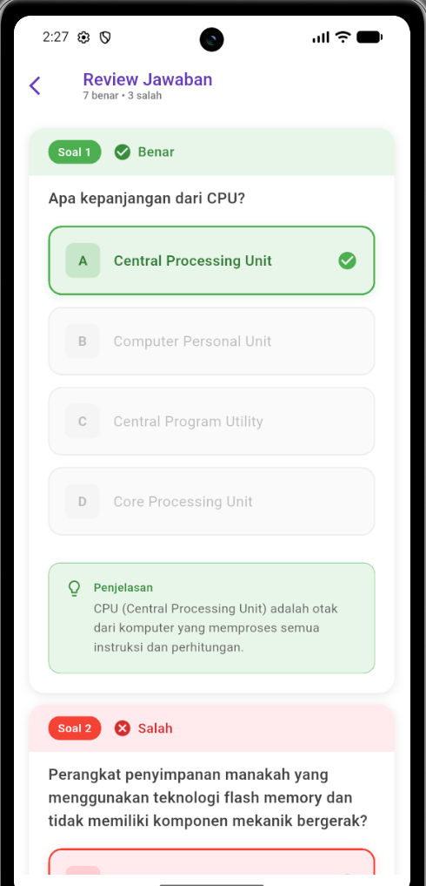
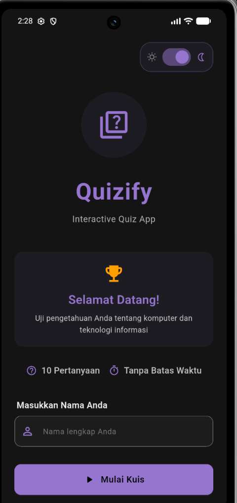
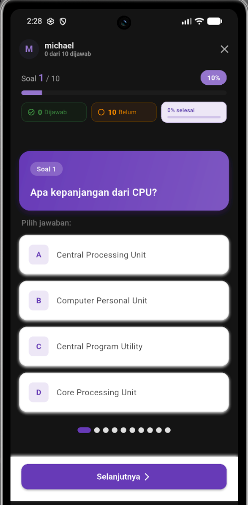
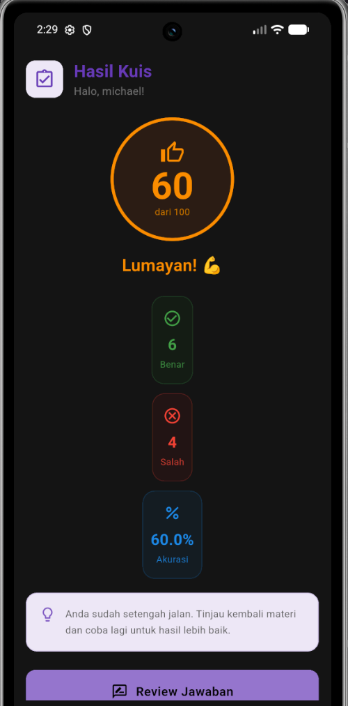
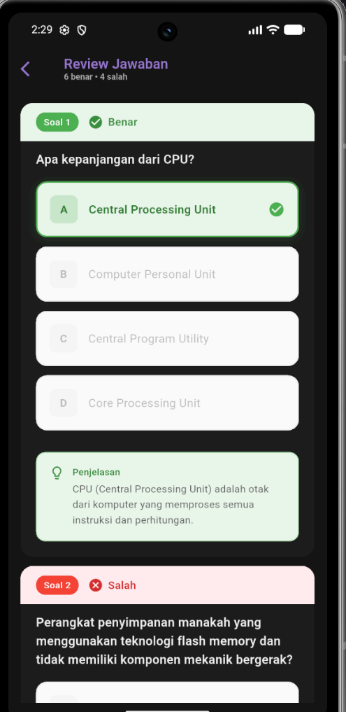

# Quizify - Interactive Quiz App

Aplikasi kuis pilihan ganda interaktif berbasis Flutter untuk menguji pengetahuan komputer dan teknologi informasi.

---

## 📋 Identitas Mahasiswa

- **Nama**: Michael Alexius Depari
- **NIM**: 241401119
- **Lab**: PM 4

---

## 📱 Informasi Aplikasi

### Nama Aplikasi
**Quizify - Interactive Quiz App**

### Deskripsi Singkat
Quizify adalah aplikasi kuis pilihan ganda yang memungkinkan pengguna memasukkan nama, menjawab 10 pertanyaan seputar komputer dan teknologi informasi, serta melihat skor akhir beserta review jawaban. Aplikasi ini dibangun menggunakan Flutter dengan Material Design 3 dan mendukung Dark/Light Mode serta responsive design.

### Fitur-Fitur yang Tersedia

1. **StatelessWidget & StatefulWidget**
   - Menggunakan StatefulWidget untuk halaman dengan state (HomePage, QuizPage)
   - Menggunakan StatelessWidget untuk halaman display (ResultPage, ReviewPage)
   - Reusable widgets (CustomButton, AnswerOption)

2. **Navigasi Antarhalaman**
   - 4 halaman: Home → Quiz → Result → Review
   - Navigator dengan push, pop, pushReplacement, dan pushAndRemoveUntil
   - Dialog konfirmasi keluar kuis

3. **Reusable Widgets**
   - `CustomButton` di `lib/widgets/custom_button.dart`
   - `AnswerOption` di `lib/widgets/answer_option.dart`

4. **Assets (Ikon)**
   - Material Icons untuk UI (quiz, trophy, lightbulb, navigation, dll)

5. **Font Kustom**
   - Google Font Poppins (4 weights: 400, 500, 600, 700)
   - Dikonfigurasi di `pubspec.yaml` sebagai local assets

6. **Responsive Layout**
   - Ukuran elemen dinamis menggunakan MediaQuery
   - Mendukung mobile, tablet, dan desktop
   - Adaptive padding dan spacing
   - Tidak ada hardcoded values

7. **State Management**
   - QuizState (ChangeNotifier) + QuizStateProvider (InheritedWidget)
   - Progres jawaban tidak hilang saat rotasi layar atau navigasi
   - Tanpa package eksternal

8. **Data Lokal**
   - 10 pertanyaan hardcoded di `lib/data/questions.dart`
   - Tanpa database atau API

9. **GitHub Commits**
   - 25+ commits bertahap per fitur
   - Commit history terstruktur
   - Repository: [Link GitHub Anda]

10. **Attractive UI**
    - Material Design 3
    - Color-coded feedback (hijau=benar, merah=salah)
    - Smooth animations
    - Professional dan polished

#### Fitur Lainnya
1. **Dark Mode & Light Mode**
   - Toggle tema di HomePage
   - Theme-aware colors di semua halaman
   - Tidak mereset progres kuis saat ganti tema

2. **Adaptive & Responsive Design**
   - 3 breakpoints: Mobile (<600px), Tablet (600-1024px), Desktop (≥1024px)
   - Tampilan rapi di smartphone, tablet, dan browser
   - Tidak ada overflow pada rotasi portrait/landscape

---

## 📸 Dokumentasi

### Screenshot Aplikasi

#### Light Mode
| Home Page | Quiz Page | Result Page | Review Page |
|-----------|-----------|-------------|-------------|
|  |  |  |  |

#### Dark Mode
| Home Page | Quiz Page | Result Page | Review Page |
|-----------|-----------|-------------|-------------|
|  |  |  |  |

*Note: Tambahkan screenshots setelah running aplikasi ke folder `assets/screenshots/`*

### Credit Sumber Assets
- **Font**: Poppins dari Google Fonts (https://fonts.google.com/specimen/Poppins)
- **Icons**: Material Icons dari Flutter SDK
- **Design**: Material Design 3 Guidelines

## 🚀 Cara Menjalankan Aplikasi

### Prerequisites
- Flutter SDK 3.0 atau lebih baru
- Dart SDK 3.0 atau lebih baru
- Android Studio / VS Code dengan Flutter extension

### Langkah-Langkah

1. **Clone Repository**
   ```bash
   git clone [https://github.com/MichaelDpy/UTS-Pemmob.git]
   cd [foldernya]
   ```

2. **Install Dependencies**
   ```bash
   flutter pub get
   ```

3. **Run Aplikasi**
   ```bash
   flutter run
   ```

4. **Build APK (Optional)**
   ```bash
   flutter build apk --release
   ```

---

## 🏗️ Struktur Proyek

```
lib/
├── data/
│   └── questions.dart          # 10 pertanyaan kuis
├── models/
│   └── question.dart           # Model data pertanyaan
├── pages/
│   ├── home_page.dart          # Halaman input nama & mulai
│   ├── quiz_page.dart          # Halaman kuis
│   ├── result_page.dart        # Halaman hasil skor
│   └── review_page.dart        # Halaman review jawaban
├── state/
│   └── quiz_state.dart         # State management kuis
├── theme/
│   └── app_theme.dart          # Light & Dark theme
├── utils/
│   ├── animations.dart         # Helper animasi
│   ├── accessibility_helper.dart
│   ├── constants.dart
│   ├── error_handler.dart
│   ├── performance_utils.dart
│   └── responsive_helper.dart
├── widgets/
│   ├── answer_option.dart      # Widget pilihan jawaban
│   └── custom_button.dart      # Widget tombol reusable
└── main.dart                   # Entry point aplikasi
```

---

## 🎯 Cara Menggunakan Aplikasi

1. **Home Page**
   - Masukkan nama Anda (minimal 2 karakter)
   - Toggle Dark/Light mode di pojok kanan atas
   - Tap tombol "Mulai Kuis"

2. **Quiz Page**
   - Baca pertanyaan dengan teliti
   - Pilih salah satu dari 4 jawaban (A, B, C, D)
   - Gunakan tombol "Selanjutnya" atau "Sebelumnya" untuk navigasi
   - Dots indicator untuk jump ke soal tertentu
   - Tap "Selesai" setelah menjawab semua soal

3. **Result Page**
   - Lihat skor Anda (0-100)
   - Lihat jumlah benar dan salah
   - Tap "Review Jawaban" untuk melihat detail
   - Tap "Ulangi Kuis" untuk mencoba lagi
   - Tap "Kembali ke Home" untuk reset

4. **Review Page**
   - Lihat semua pertanyaan dan jawaban
   - Warna hijau = jawaban benar
   - Warna merah = jawaban salah
   - Lihat penjelasan setiap jawaban

---

## 💻 Teknologi yang Digunakan

- **Framework**: Flutter 3.0+
- **Language**: Dart 3.0+
- **Design System**: Material Design 3
- **State Management**: ChangeNotifier + InheritedWidget
- **Font**: Google Fonts Poppins
- **Version Control**: Git & GitHub

**Tanpa package eksternal** - murni menggunakan Flutter SDK bawaan.

---

## 📝 Catatan Pengembangan

- Development approach: Incremental, tidak monolithic
- Code style: Clean, modular, mudah dipahami
- No warnings atau errors
- Production-ready code

---

## 👨‍💻 Kontak

- **GitHub**: [MichaelDpy]
- **Email**: [michael.dpy06@gmail.com]

---

**Dibuat dengan ❤️ menggunakan Flutter untuk UTS Pemrograman Mobile**
